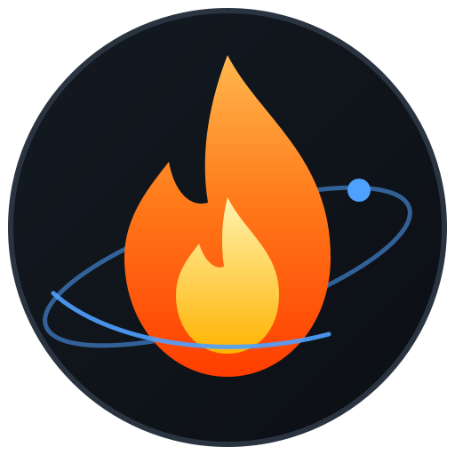
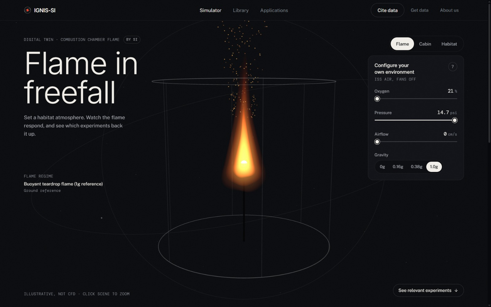
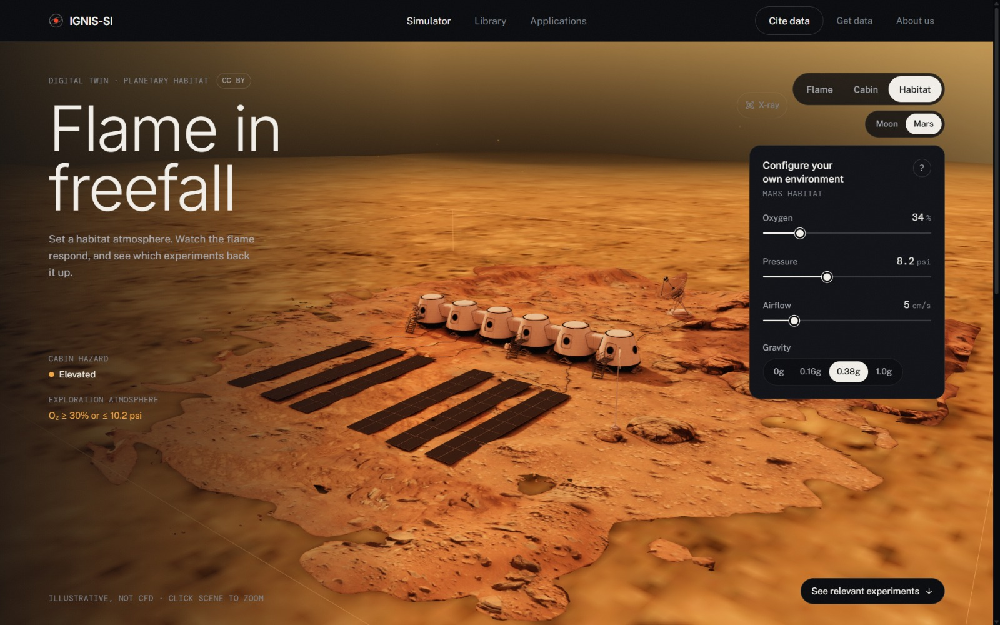
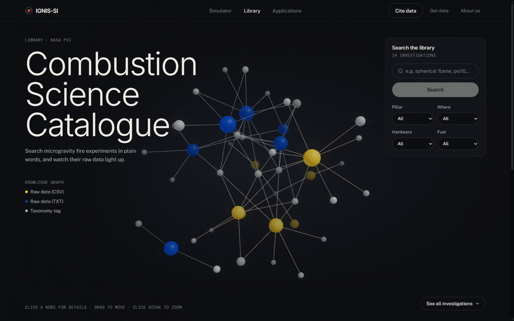
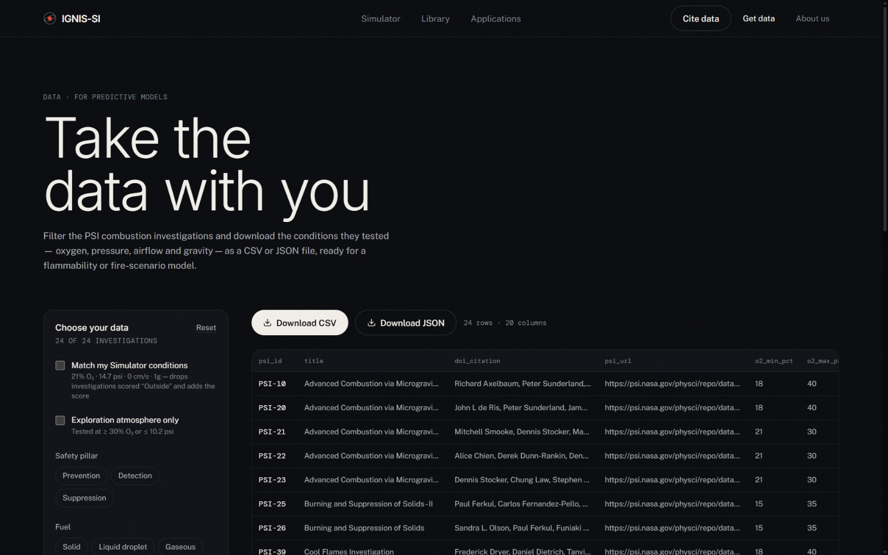
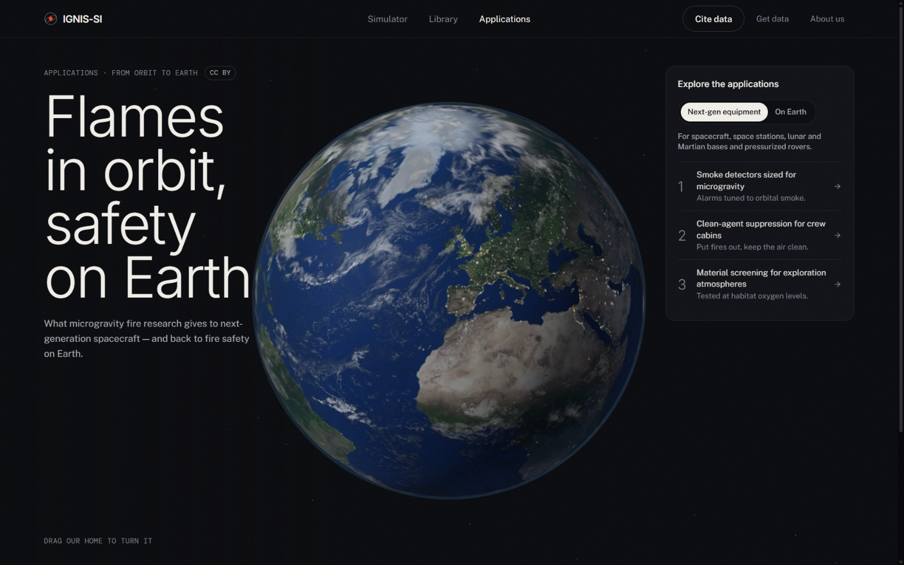
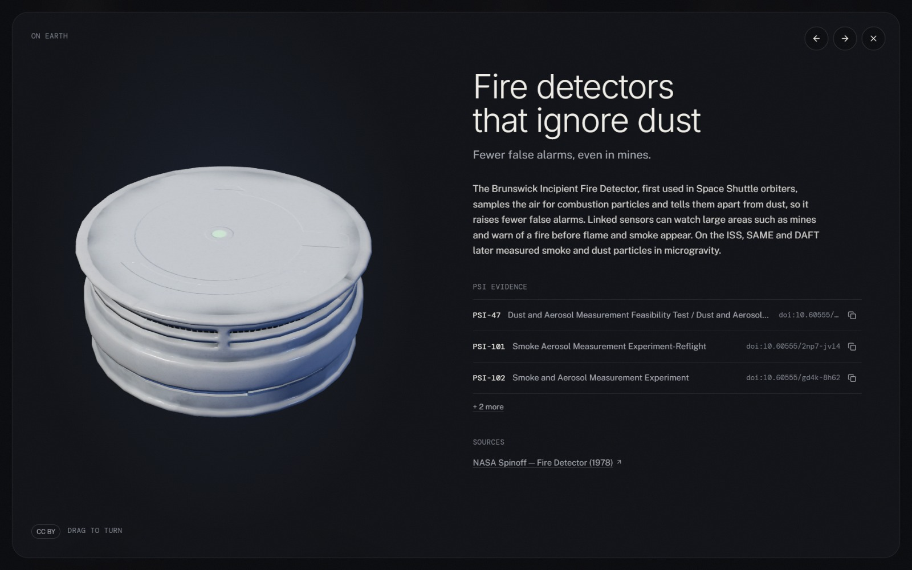
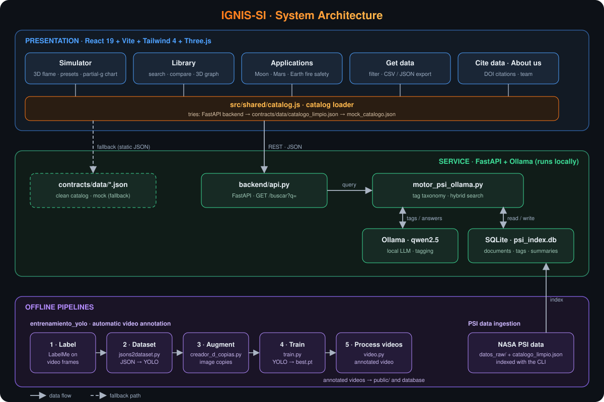

<a id="readme-top"></a>

<div align="center">



# IGNIS-SI

***Explore NASA's microgravity combustion experiments in minutes, not weeks.***

<br>

[](https://react.dev/)
[](https://vitejs.dev/)
[](https://tailwindcss.com/)
[](https://threejs.org/)
[](https://www.python.org/)
[](https://fastapi.tiangolo.com/)
[](https://ollama.com/)
[](https://www.sqlite.org/)
[](https://docs.ultralytics.com/)
[](LICENSE)

<br>

[About](#about) ·
[Summary](#project-summary) ·
[Demo](#demo) ·
[Features](#main-features) ·
[Structure](#repository-structure) ·
[Architecture](#architecture) ·
[Installation](#installation) ·
[Running](#running-the-system) ·
[YOLO](#training-the-yolo-model) ·
[Compliance](#nasa-space-apps-compliance) ·
[Authors](#authors) ·
[License](#license)

</div>

---

## About

**IGNIS-SI** was developed for the **NASA Space Apps Challenge**. NASA's **Physical Sciences Informatics (PSI)** database holds the results of many combustion experiments run in microgravity, but this knowledge is spread across hundreds of records and raw data files. For a mission planner designing the fire safety of a spacecraft cabin or a lunar base, finding the right experiment, comparing it with others and understanding what it implies can take weeks.

IGNIS-SI brings that knowledge together in one place, so the evidence behind fire-safety decisions for future exploration can be found, compared and understood quickly, with the citation of every investigation always at hand.

## Project Summary

IGNIS-SI is a web application that turns NASA's PSI microgravity combustion experiments into something a mission planner can explore in minutes instead of weeks. Since the data is hard to find, hard to compare and hard to interpret, IGNIS-SI offers three connected tools.

### 1. Interactive, animated simulator

Users change experiment variables (gravity level, atmosphere, oxygen concentration or pressure, among others) and see how flame behavior changes across environments.

<table>
  <tr>
    <td width="50%"></td>
    <td width="50%"></td>
  </tr>
  <tr>
    <td align="center"><sub>3D flame and environment controls</sub></td>
    <td align="center"><sub>Mars habitat simulator and evironment controls</sub></td>
  </tr>
</table>

### 2. Plain-language search

A locally run LLM with **Ollama**, working over a structured **SQLite** database of PSI investigations, understands a question such as *"how does low oxygen affect flame spread?"* and returns the most relevant experiments.

<table>
  <tr>
    <td width="50%"></td>
    <td width="50%"></td>
  </tr>
  <tr>
    <td align="center"><sub>Natural-language search and filters</sub></td>
    <td align="center"><sub>Data downloader section</sub></td>
  </tr>
</table>

### 3. Research tab

Links current microgravity combustion studies to future research on next-generation fire-safety controls and equipment for cabins and bases on the lunar and Martian surfaces. Furthermore, on Earth, possible applications are included to support fire-safety decisions.

<table>
  <tr>
    <td width="50%"></td>
    <td width="50%"></td>
  </tr>
  <tr>
    <td align="center"><sub>Applications on Earth</sub></td>
    <td align="center"><sub>Real-world use case</sub></td>
  </tr>
</table>

## Demo

<!-- Replace with your video:
[](https://youtu.be/XXXXXXXXXXX)
> Click the image to open the demo.
-->

A demo video will be linked here.

## Main Features

- **Animated 3D flame simulator** (React Three Fiber) with presets, a match score against real PSI experiments, hazard and advisory rules, and a partial-gravity chart.
- **Natural-language search** powered by a local LLM (`qwen2.5` through Ollama), with a closed tag taxonomy (PSI IDs, gravity regime, atmosphere, fuel phase, hardware rack, sensors, flame phenomena) and hybrid ranking over a SQLite index.
- **Investigation library** with filters, local search with domain synonyms, side-by-side comparison ("what changed / what stayed the same") and a 3D knowledge graph.
- **Applications tab** covering next-generation fire-safety equipment for lunar and Martian habitats and fire-safety decisions on Earth, with 3D objects and documented NASA sources.
- **Get data** page to filter the catalog and download **CSV / JSON** for your own models.
- **Computer-vision annotation pipeline** (YOLO) to automatically annotate combustion videos for the database: raw fuel, flame, burning fuel and fuel residue.
- **Data attribution built in:** every PSI investigation shows its `psi_id` and an official DOI citation ("Cite this Investigation").
- **Transparent use of SI:** SI-generated summaries and visuals are explicitly marked as *SI-Assisted Analysis*.

## Repository Structure

```text
IGNIS-SI/
├── package.json / vite.config.js / index.html
├── requirements.txt
├── CLAUDE.md                 # Team workflow and Space Apps compliance rules
├── docs/
│   ├── assets/               # Logo, architecture diagram, icons
│   └── screenshots/          # Screenshots used in this README
├── backend/
│   ├── api.py                # FastAPI server (GET /buscar?q=...)
│   ├── motor_psi_ollama.py   # PSI indexing, LLM tagging and hybrid search (SQLite + Ollama)
│   ├── nube.py               # Knowledge-graph generation from the index (pyvis)
│   ├── catalogo_limpio.json  # Cleaned PSI catalog
│   ├── datos_raw/            # Raw PSI data files to classify and index
│   └── lib/                  # Graph visualization libraries
├── contracts/
│   ├── schema.py             # Python data contract
│   ├── types.ts              # TypeScript data contract
│   └── data/                 # catalogo_limpio.json and mock_catalogo.json
├── entrenamiento_yolo/
│   └── entrenamiento_yolo/
│       ├── frames/               # Video frames + LabelMe annotations (.json)
│       ├── jsons2dataset.py      # LabelMe JSON → YOLO dataset
│       ├── creador_d_copias.py   # Data augmentation (image copies)
│       ├── train.py              # YOLO training
│       ├── dataset_yolo/         # Generated dataset (images, labels, dataset.yaml)
│       └── renderizar_videos/
│           └── video.py          # Run the trained model over a video
├── src/
│   ├── App.jsx / main.jsx / index.css
│   ├── pages/
│   │   ├── simulator/        # Simulator tab
│   │   ├── library/          # Library tab
│   │   ├── earth/            # Applications tab (3D models + content)
│   │   ├── data/             # Get data (CSV / JSON export)
│   │   └── about/            # About us
│   └── shared/               # Catalog loader, citation modal, UI components
├── public/                   # Static assets and 3D models
└── inspo/                    # Design inspiration and references
```

## Architecture

<p align="center">
  
</p>

**How the pieces talk to each other**

- **Frontend → data.** The catalog loader (`src/shared/catalog.js`) asks the FastAPI backend first (`VITE_API_URL`, default `http://localhost:8000`). If it is not reachable, it falls back to `contracts/data/catalogo_limpio.json` and finally to `mock_catalogo.json`, so the app keeps working without the backend.
- **Search.** The Library sends the user's question to `GET /buscar?q=...`. `api.py` forwards it to `motor_psi_ollama.py`, which combines the local LLM (Ollama) with a hybrid query over the SQLite index and returns the most relevant files and experiments.
- **Indexing.** NASA PSI data (`datos_raw/` and `catalogo_limpio.json`) is classified with the LLM using a closed tag taxonomy and stored in `psi_index.db`.
- **Computer vision.** The `entrenamiento_yolo` pipeline runs offline: frames are labeled, converted to a YOLO dataset, augmented and used to train a model that annotates the combustion videos used by the database and the app.

### Components

**Frontend (`src/`, `public/`, `index.html`).** React 19 + Vite application styled with Tailwind CSS 4. 3D scenes use `three`, `@react-three/fiber` and `@react-three/drei`; charts use Recharts. Each tab has its own folder under `src/pages/` (see [`src/README.md`](src/README.md)).

**Backend (`backend/`).** `motor_psi_ollama.py` classifies and indexes the catalog and raw files, `api.py` exposes the search through FastAPI, and `nube.py` builds an interactive knowledge graph of the indexed documents.

**Data contracts (`contracts/`).** `schema.py` and `types.ts` define the shared investigation format, so frontend and backend evolve in a coordinated way.

**Computer vision (`entrenamiento_yolo/`).** Offline pipeline to train a custom YOLO model. See [Training the YOLO Model](#training-the-yolo-model).

## Requirements

- **Git**
- **Node.js** 18+ and **npm**
- **Python 3.10.19** (use Miniconda / Conda or `pyenv` to pin the exact version)
- **[Ollama](https://ollama.com/)** running locally, for the LLM-based search
- An NVIDIA GPU is recommended for YOLO training (`requirements.txt` pins CUDA 12.1 builds of PyTorch)

## Installation

Clone the repository:

```bash
git clone https://github.com/belencorvillo/IGNIS-SI.git
cd IGNIS-SI
```

Install the frontend dependencies:

```bash
npm install
```

Install the backend dependencies, using Conda:

```bash
conda create -n ignis-si python=3.10.19
conda activate ignis-si
pip install -r requirements.txt
```

or `pyenv` + `venv`:

```bash
pyenv install 3.10.19
pyenv local 3.10.19
python -m venv .venv
source .venv/bin/activate        # On Windows: .venv\Scripts\activate
pip install -r requirements.txt
```

> `requirements.txt` is a full environment freeze that also covers the YOLO training tools (Ultralytics, Albumentations, LabelMe) and is large.

Download the local LLM used by the search engine:

```bash
ollama pull qwen2.5
```

## Running the System

### 1. Index the PSI data (first run only)

```bash
cd backend
python motor_psi_ollama.py --catalog catalogo_limpio.json
```

This creates the SQLite index (`psi_index.db`), indexes the catalog and then classifies the raw files in `datos_raw/`. Useful options:

| Option | Description |
|---|---|
| `--catalog <file>` | Path to the catalog JSON to index. |
| `--folder <dir>` | Raw data folder to classify (default `datos_raw`). |
| `--file <path>` | Classify and index a single file. |
| `--search "<query>"` | Run a semantic search from the command line. |
| `--no-search` | Skip the test search after indexing. |

### 2. Start the backend API

```bash
cd backend
uvicorn api:app --reload --port 8000
```

Example request: `http://localhost:8000/buscar?q=how does low oxygen affect flame spread`

### 3. Start the frontend

```bash
npm run dev
```

The app is available at `http://localhost:5173`. To point it at a different backend, set `VITE_API_URL`.

### Scripts

| Command | Description |
|---|---|
| `npm run dev` | Vite development server. |
| `npm run build` | Production build. |
| `npm run preview` | Preview the production build. |
| `npm run lint` | Static analysis with Oxlint. |

## Training the YOLO Model

The `entrenamiento_yolo` folder contains the pipeline used to train a new model for the **automatic annotation of videos**. Run the scripts from `entrenamiento_yolo/entrenamiento_yolo/`.

**Classes:** `raw_fuel`, `flame`, `burning_fuel`, `fuel_residue`.

> The LabelMe labels must use the exact names defined in `jsons2dataset.py` (`conbustible_raw`, `llama`, `combustible_quemando`, `residuo_combustible`). `video.py` then renames the classes to English for the rendered output.

1. **Extract and label the frames.** Place the frames of the videos you want to detect inside `frames/`, then label them with **LabelMe** (`labelme`). One `.json` file is created next to each image. Images without annotations are kept as negative (background) examples.
2. **Create the YOLO dataset.**
   ```bash
   python jsons2dataset.py
   ```
   Converts the LabelMe annotations into YOLO format and creates the 80% / 20% train/validation split in `dataset_yolo/`.
3. **Augment the dataset.**
   ```bash
   python creador_d_copias.py
   ```
   Creates several copies of each training image (brightness/contrast, noise and color-shift variations, with no geometric changes) to enlarge the dataset and make the model more robust.
4. **Train the model.**
   ```bash
   python train.py
   ```
   Fine-tunes a YOLO nano model (`yolo26n.pt`) on `dataset_yolo/dataset.yaml` for 60 epochs at 1024 px. The resulting weights are saved by Ultralytics under `runs/detect/.../weights/best.pt`.
5. **Process the videos.** Copy `best.pt` and the video next to `renderizar_videos/video.py`, then run:
   ```bash
   cd renderizar_videos
   python video.py
   ```
   Runs the trained model frame by frame and writes the annotated video (`resultado_ISS.avi`), which feeds the database. Video files (`*.mp4`, `*.avi`, ...) are excluded from Git.

## NASA Space Apps Compliance

- **Language:** all UI text, charts, summaries and documentation are in English.
- **Data attribution:** every PSI investigation includes its `psi_id` and official `doi_citation`.
- **SI transparency:** SI-generated summaries and visuals are clearly marked as *SI-Assisted Analysis*.
- **Branding:** no official NASA logos, flags or mission insignias are used. This project is **not affiliated with or endorsed by NASA**.
- **Scientific scope:** rocket engines and propellants are excluded, because high flow velocities make combustion gravity-independent.

## Notes

- **Exploration-atmosphere flag:** a cabin is flagged when O₂ ≥ 30% **or** pressure ≤ 10.2 psi, since either condition takes it out of the Earth-normal regime (21% O₂, 14.7 psi). NASA's recommended exploration atmosphere is 34% O₂ at 8.2 psi; the EVA suit uses 100% O₂ at 4.3 psi.
- **Hardware racks:** CIR (ACME gaseous flames, MDCA liquid droplets) and MSG (SPICE forced-flow duct).
- **Partial gravity:** bounded through 0g ISS data, 1g ground references and ACME E-FIELD electric-field proxies (awaiting LUCI and FM2).
- Large NASA PSI data files and videos are not stored in this repository.
- The simulator is a decision-support tool for exploration and comparison, not a replacement for certified fire-safety analysis.

## Authors

<table>
  <tr>
    <td align="center" width="25%">
      <b>Belén Corvillo Guerra</b><br>
      <a href="https://www.linkedin.com/in/belen-corvillo-guerra/"></a>
    </td>
    <td align="center" width="25%">
      <b>Eduardo Ugarte Álvarez</b><br>
      <a href="https://www.linkedin.com/in/eduardo-ugarte-%C3%A1lvarez-637906334/"></a>
    </td>
    <td align="center" width="25%">
      <b>Mario Rodríguez Barrera</b><br>
      <a href="https://www.linkedin.com/in/mario-rod-barrera/"></a>
    </td>
    <td align="center" width="25%">
      <b>Víctor Gil Ferrer</b><br>
      <a href="https://www.linkedin.com/in/v%C3%ADctor-gil-ferrer-43baa3394/"></a>
    </td>
  </tr>
</table>

## Acknowledgements

Experiment data comes from NASA's **Physical Sciences Informatics (PSI)** database. Please cite each investigation with its DOI, as shown in the app ("Cite data").

## License

This project is licensed under the MIT License. See the [LICENSE](LICENSE) file for details. NASA PSI data remains subject to its own terms of use.

<br>

<p align="center"><a href="#readme-top"><b> Back to top</b></a></p>
